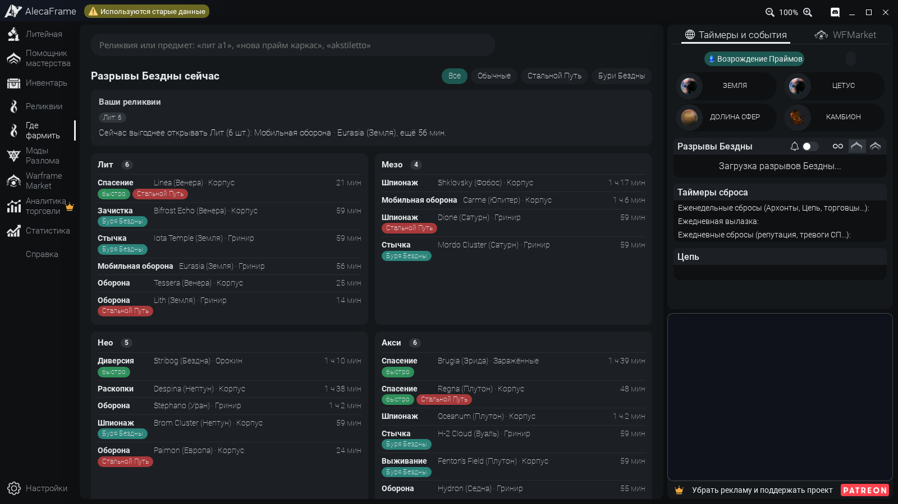
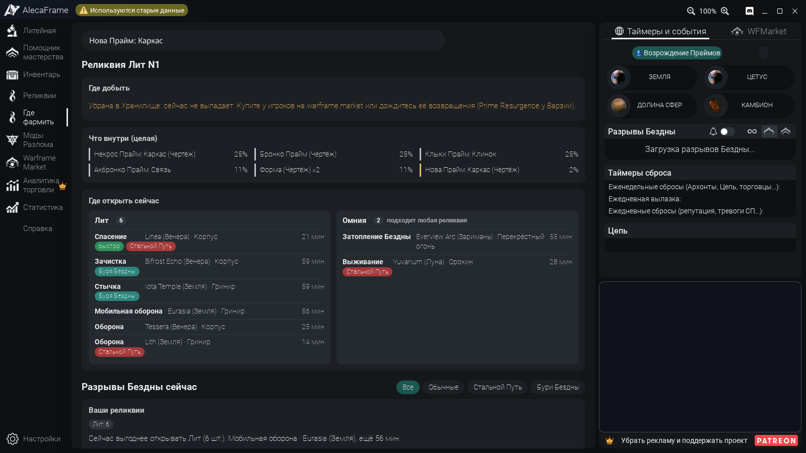
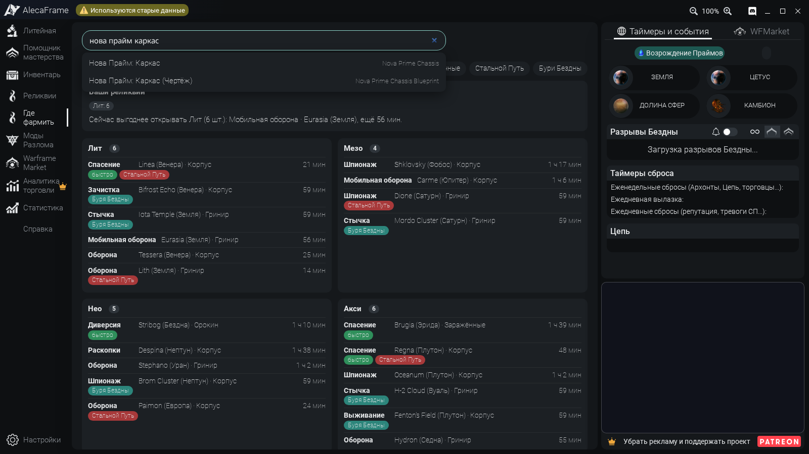
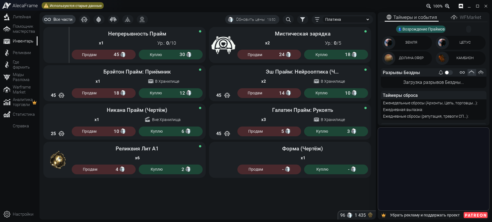
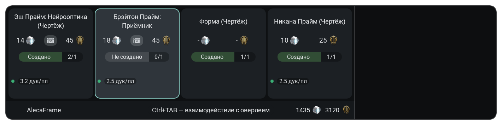
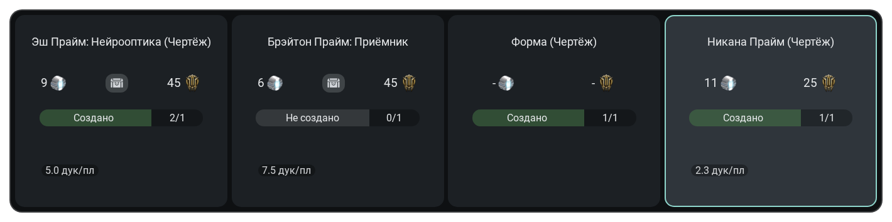
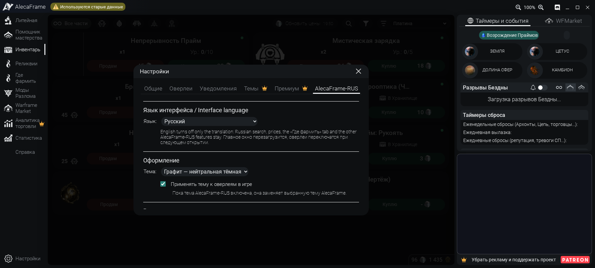
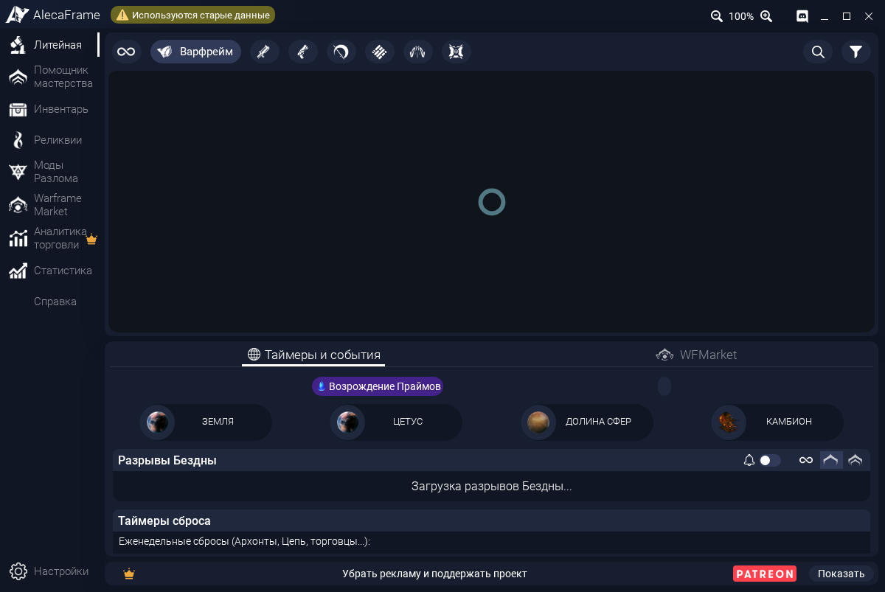

<h1> AlecaFrame-RUS</h1>

Русификатор AlecaFrame для Warframe: полный перевод, поиск на русском, вкладка «Где фармить» с живыми разрывами Бездны и мгновенные цены warframe.market в окне наград реликвии

[](https://github.com/TuftyTech/AlecaFrame-RUS/releases/latest/download/AlecaFrame-RUS.zip)
[](#документация)
[](README.en.md)
[](https://github.com/TuftyTech/AlecaFrame-RUS/actions/workflows/ci.yml)
[](https://github.com/TuftyTech/AlecaFrame-RUS/actions/workflows/release.yml)
[](https://github.com/TuftyTech/AlecaFrame-RUS/releases)
[](https://github.com/TuftyTech/AlecaFrame-RUS/releases/latest)
[](https://alecaframe.com/)
[](#установка)
[](LICENSE)
[](https://github.com/TuftyTech/AlecaFrame-RUS)

<div>
  <a href="https://github.com/TuftyTech/AlecaFrame-RUS/releases/latest/download/AlecaFrame-RUS.zip">
    
  </a>
  &nbsp;
  <a href="https://github.com/TuftyTech/AlecaFrame-RUS/releases">
    
  </a>
</div>

# Документация

Первый раз здесь? **[Начните с установки](#установка)**: пара минут и один вопрос «да / нет». Нужен текст на английском? **[README in English](README.en.md)**.

> [!CAUTION]
> **Это неофициальный проект, автор AlecaFrame его не проверял.** Чтобы подключить перевод, Overwolf запускается с ослабленной проверкой файлов приложений. Это касается **всех** приложений Overwolf, пока AlecaFrame-RUS установлен. Подробно в разделе [«Безопасность»](#безопасность). Подписку, Patreon и платные функции AlecaFrame проект не трогает.

# Разделы:

- [Документация](#документация)
- [Возможности](#-возможности)
  - [Перевод](#перевод)
  - [Поиск на русском](#поиск-на-русском)
  - [Где фармить](#где-фармить)
  - [Цены и окно наград реликвии](#цены-и-окно-наград-реликвии)
  - [Реклама и интерфейс](#реклама-и-интерфейс)
  - [Установка и язык](#установка-и-язык)
  - [Ещё немного полезного](#ещё-немного-полезного)
- [Как это работает](#как-это-работает)
- [Скриншоты](#скриншоты)
- [Установка](#установка)
  - [Обновление](#обновление)
  - [Удаление](#удаление)
  - [Если что-то пошло не так](#если-что-то-пошло-не-так)
  - [Безопасность](#безопасность)
  - [Что проверено](#что-проверено)
- [Для разработчиков](#для-разработчиков)
- [Благодарности](#благодарности)
- [Перевод и участие](#перевод-и-участие)
- [Поддержка](#поддержка)
- [Ссылки](#ссылки)
- [Лицензия](#лицензия)

# 🎉 Возможности

- Всё, что умеет AlecaFrame, только по-русски, и немного больше:

## Перевод

- **900 из 900 строк** интерфейса AlecaFrame 2.6.90: меню, кнопки, настройки, подсказки, оверлеи реликвий и модов Разлома, TennoFinder, список изменений.
- Термины как в русской версии Warframe: Литейная, Моды Разлома, Реликвии, Стальной Путь, Бури Бездны.
- **Названия предметов** из официальной локализации игры: «Нова Прайм: Система (Чертёж)», «Мистическая зарядка», «Лит G1 (целая)». Около 400 предметов, у которых нет русского названия ни в игре, ни на warframe.market, остаются на английском.
- **Копирование названий:** клик по названию предмета во вкладке «Инвентарь» копирует его в буфер обмена по-русски. Если перевода нет или интерфейс переключён на English, копируется английское название. На полторы секунды вместо названия появляется «Скопировано». Окно предмета при этом не открывается, клик по остальной карточке работает как раньше.
- **Окно «О предмете»** целиком: описания, способности, эффекты модов по рангам, характеристики оружия, дерево создания.
- Где русский текст длиннее английского, подправлены отступы. Каждое такое правило подтверждено отчётом о переполнениях в headless Chrome.

## Поиск на русском

- AlecaFrame ищет только по английским названиям. AlecaFrame-RUS учит русскому **все поля поиска**: Литейная, Инвентарь, Реликвии, Моды Разлома, WFMarket и новая вкладка «Где фармить».
- Начала слов в любом порядке: «нова прайм сист» находит «Нова Прайм: Система».
- Неправильная раскладка: «ytrjhf» понимается как «некора», «ыщьф» как «soma».
- Случайные совпадения отбрасываются: «эш» находит Эша, а не «Fl**ash**».
- Английские запросы уходят в AlecaFrame как есть.

## Где фармить

Новая вкладка в боковом меню отвечает на вопрос «какую реликвию где добыть и где её открыть прямо сейчас».

- **Реликвия:** где выпадает (миссия, ротация, шанс) и какие разрывы её эры открыты сейчас, с таймером.
- **Prime-часть или комплект:** какие реликвии её дают, редкость и шанс, выпадает ли реликвия или уже убрана в Хранилище. Для убранных подсказка купить у игроков.
- **Активные разрывы** по эрам, отдельно обычные, Стальной Путь и Бури Бездны. Быстрые миссии (Захват, Зачистка, Диверсия, Спасение) идут первыми.
- **«Ваши реликвии»:** сколько реликвий каждой эры есть в инвентаре и какую эру выгоднее открыть прямо сейчас.
- Данные: таблицы выпадения Digital Extremes и состояние мира через [api.warframestat.us](https://api.warframestat.us). Пока вкладка открыта, разрывы обновляются раз в минуту.

## Цены и окно наград реликвии

- **Свежая цена при каждом открытии окна.** Цены всех наград заново берутся из **текущих заказов warframe.market** (самый дешёвый продавец в игре), награды запрашиваются одновременно. Это тот же клиент AlecaFrame, что у кнопки «Обновить цены»: он обращается к warframe.market напрямую, без серверов AlecaFrame.
- Пока ответ в пути (обычно около секунды), видна прежняя цена или средняя цена сделок за сутки (загружается заранее для всех Prime-частей, около 70 КБ раз в 3 часа), точка у цены мигает. **Зелёная точка: цена свежая.** Серая: свежую получить не удалось, причина в подсказке.
- На карточке награды **дукаты за платину** (от 10 и выше обычно выгоднее сдать Баро Ки'Тиру) и **сколько частей комплекта у вас не хватает**.
- Окно запускается, как только страница готова. Сам AlecaFrame ждёт ещё и загрузки рекламы.
- Исправлена ошибка AlecaFrame: когда ни у одной награды нет цены, подсвечивались все карточки сразу.
- Кнопка **«Обновить цены»** во вкладке «Инвентарь» берёт текущие заказы для показанных предметов с учётом ранга модов и улучшения реликвий. Не чаще 3 запросов в секунду, как требует warframe.market. Сортировка «Платина» и «Дуканатор» пересчитывается по новым ценам.

## Реклама и интерфейс

- **«Сворачивать рекламный блок в главном окне»:** блок 400×300 сжимается в полоску со ссылкой на Patreon, место занимают таймеры и события.
- **«Скрывать рекламу в оверлеях»:** окно наград реликвии, оверлей ривенов и AFBuilds показывают только содержимое, окно наград становится уже.
- Пока блок скрыт, реклама не загружается и не засчитывает показы, которых никто не видел. Обе галочки по умолчанию выключены.
- **Скрытие вкладок** бокового меню, которыми вы не пользуетесь.
- **Тема «Графит»:** нейтральная тёмная тема с бирюзовым акцентом, по желанию и для оверлеев в игре.

## Установка и язык

- Один `Install.cmd` и **один вопрос**. Дальше AlecaFrame открывается на русском сам: после перезагрузки Windows и после обновлений AlecaFrame и Overwolf.
- Ярлыки «AlecaFrame (русский)» и запись в «Параметры → Приложения» для удаления.
- **Язык в настройках:** Русский, English (original) или «Как в Windows». Переключается без переустановки. На английском выключается только перевод, поиск и дополнения остаются.

## Ещё немного полезного

- **Идеи игроков.** Дукаты за платину и недостающие части комплекта знакомы по WFInfo, остальное собрано из документации AlecaFrame и его списка изменений («Suggested by»).
- **Ничего лишнего в файлах.** DLL AlecaFrame, его данные и файлы игры не меняются. В 9 страниц добавляется одна строка `<script>`, а когда Overwolf закрыт, файлы побайтово возвращаются в исходный вид.
- **`window.__AF_RU__.missing()`** в консоли AlecaFrame показывает тексты, которые встретились без перевода.
- **48 автотестов** (Node, jsdom, Vue 3.2.31, как в AlecaFrame) и **65 проверок установщика** запускаются в CI на Linux и на Windows с PowerShell 5.1 и 7.

# Как это работает

```
Install.cmd ──► %LOCALAPPDATA%\AlecaFrame-RU\app, автозагрузка, ярлыки
                        │
                        ▼
Agent.ps1  (фоновый процесс без окна, раз в 2 секунды)
  ├─ Overwolf запущен без флагов?   перезапускает с флагами
  ├─ флаги на месте?                добавляет <script src="alecaframe-ru.js"> в 9 страниц
  └─ Overwolf закрыт?               возвращает исходные файлы AlecaFrame
                        │
                        ▼
alecaframe-ru.js  (в каждом окне AlecaFrame)
  ├─ localizer   перевод DOM через MutationObserver, Vue подмены не замечает
  ├─ search      русский запрос → английский фрагмент → лишнее отбрасывается
  ├─ extras      цены, окно наград, реклама, вкладки, тема, настройки
  └─ farm        вкладка «Где фармить» (только главное окно)
```

> [!NOTE]
> **Почему не патч DLL:** Overwolf сверяет файлы каждого приложения с подписанным списком и закрывает изменённый AlecaFrame с `HashMismatch`. Флаги Overwolf обходят это без изменения DLL, данных и подписки, а вся логика живёт в обычном JavaScript, который можно прочитать.

# Скриншоты

| Где фармить | Реликвия и разрывы |
|:---:|:---:|
|  |  |

| Поиск на русском | Инвентарь и «Обновить цены» |
|:---:|:---:|
|  |  |

| Окно наград реликвии | Без рекламы в оверлее |
|:---:|:---:|
|  |  |

| Настройки → AlecaFrame-RUS | Свёрнутый рекламный блок |
|:---:|:---:|
|  |  |

<sub>Настоящие страницы AlecaFrame 2.6.90 в headless Chrome. Инвентарь и награды поддельные, разрывы и таблицы выпадения настоящие, с api.warframestat.us.</sub>

# Установка

| Платформа | Стабильная версия |
|---|---|
| **Windows 10 / 11** | [](https://github.com/TuftyTech/AlecaFrame-RUS/releases/latest/download/AlecaFrame-RUS.zip) [](https://github.com/TuftyTech/AlecaFrame-RUS/releases/latest/download/SHA256SUMS.txt) |

Нужен [Overwolf](https://www.overwolf.com/) с установленным **AlecaFrame**, который вы хотя бы раз открывали. Node.js, Python и прочие программы не нужны.

1. Скачайте **[AlecaFrame-RUS.zip](https://github.com/TuftyTech/AlecaFrame-RUS/releases/latest/download/AlecaFrame-RUS.zip)** и распакуйте в любую папку, хоть в «Загрузки». После установки архив и папку можно удалить.
2. Выйдите из игры. Overwolf закрывать не нужно, установка перезапустит его сама.
3. Дважды щёлкните **`Install.cmd`**. Если Windows покажет SmartScreen, нажмите **«Подробнее → Выполнить в любом случае»**: это обычные текстовые скрипты, их можно открыть в Блокноте.
4. Прочитайте, что будет сделано, введите `да` и нажмите Enter. Вопрос один: оба флага Overwolf разрешаются одним согласием.
5. Подождите, обычно меньше минуты. Overwolf перезапустится, AlecaFrame откроется на русском, в окне установки появится «Готово».

> [!TIP]
> **Что появится после установки:**
>
> - фоновый процесс без окна в автозагрузке Windows. Если Overwolf запустился сам вместе с Windows, процесс один раз перезапустит его с нужными флагами, это нормально;
> - ярлыки **«AlecaFrame (русский)»** на рабочем столе и в меню «Пуск»: открывают AlecaFrame, а если Overwolf не запущен, то и его;
> - запись **AlecaFrame-RUS** в «Параметры → Приложения».
>
> AlecaFrame можно открывать и обычным способом, через Overwolf: перевод будет и там. Все дополнения находятся в **Настройки (шестерёнка внизу слева) → AlecaFrame-RUS**.

### Обновление

Скачайте новый `AlecaFrame-RUS.zip`, распакуйте и запустите `Install.cmd`. Он остановит прежний фоновый процесс, заменит файлы и снова откроет AlecaFrame. Повторно соглашаться не нужно, в том числе при переходе с AlecaFrame-RU 0.4.

Обновления самого AlecaFrame ставятся как обычно, перевод подключится к новой версии сам. Если часть надписей стала английской, значит, в новой версии появились новые строки: пришлите их через [форму перевода](https://github.com/TuftyTech/AlecaFrame-RUS/issues/new?template=translation.yml).

### Удаление

**«Параметры → Приложения → AlecaFrame-RUS → Удалить»** или `Uninstall.cmd` из архива. Удаление останавливает фоновый процесс, перезапускает Overwolf обычным образом, возвращает исходные файлы AlecaFrame и убирает автозагрузку, ярлыки, запись в «Приложениях» и папку `%LOCALAPPDATA%\AlecaFrame-RU`.

### Если что-то пошло не так

| Что видите | Что делать |
| --- | --- |
| AlecaFrame на английском | Откройте его ярлыком «AlecaFrame (русский)», он запустит фоновый процесс. Не помогло: запустите `Install.cmd` ещё раз. Проверьте, что в **Настройки → AlecaFrame-RUS → Язык интерфейса** выбран русский. |
| Overwolf перезапускается при запуске | Один перезапуск нормален: Overwolf стартовал без флагов. Больше двух перезапусков за 10 минут процесс не делает. |
| Окно с вопросом про `force-validation-report-only` | Ответьте «да», ответ запомнится. Ответили «нет»: запустите `Install.cmd` ещё раз. |
| «Overwolf закрыл изменённый AlecaFrame даже в режиме force-validation-report-only» | С вашей сборкой Overwolf перевод пока не работает, файлы уже возвращены. Создайте [issue](https://github.com/TuftyTech/AlecaFrame-RUS/issues/new?template=bug-report.yml) и приложите `launcher.log`. |
| «Overwolf запущен от имени администратора» | Фоновый процесс не видит флагов такого Overwolf. Выйдите из Overwolf и запустите его обычным способом. |
| Окно наград: «Язык Warframe не поддерживается» | Это распознавание наград самого AlecaFrame, оно работает с игрой на английском, французском, испанском и немецком. Переключите язык Warframe, интерфейс AlecaFrame останется русским. |
| «Где фармить»: нет связи с api.warframestat.us | Таблицы выпадения и разрывы берутся оттуда. Проверьте интернет и попробуйте ещё раз. |
| «Обновить цены» пишет «нет связи» | AlecaFrame не ответил на запрос к warframe.market. Проверьте, что AlecaFrame запущен, и нажмите ещё раз. |
| Часть надписей на английском | Скорее всего, ваша версия AlecaFrame новее 2.6.90. Пришлите строки через [форму перевода](https://github.com/TuftyTech/AlecaFrame-RUS/issues/new?template=translation.yml). |
| AlecaFrame не открывается или сразу закрывается | Запустите `Uninstall.cmd`, затем `Install.cmd`. Не помогло: переустановите AlecaFrame через Overwolf. |

Журнал фонового процесса: `%LOCALAPPDATA%\AlecaFrame-RU\launcher.log`. Вставьте путь в адресную строку Проводника. Папка называется AlecaFrame-RU, как в прошлых версиях, чтобы обновление подхватило прежние настройки.

### Безопасность

Overwolf проверяет файлы каждого приложения по подписанному списку и закрывает изменённый AlecaFrame. Любой способ подключить перевод требует ослабить эту проверку. Здесь это сделано так:

- фоновый процесс запускает Overwolf с `--ow-disable-features=extension-validation,read-opk-from-memory` и `--ow-enable-features=force-validation-report-only`. С ними Overwolf по-прежнему сверяет файлы, но при несовпадении только пишет об этом в свой журнал;
- это действует **для всех приложений Overwolf** и **всё время, пока AlecaFrame-RUS установлен**. После удаления Overwolf снова запускается с полной проверкой;
- в 9 страниц AlecaFrame добавляется одна строка `<script src="assets/js/alecaframe-ru.js">`. Если её убрать, файл побайтово совпадёт с исходным, это проверяют тесты. Когда Overwolf закрыт или запущен без флагов, строка убрана;
- фоновый процесс `windows\Agent.ps1` можно прочитать. Раз в 2 секунды он смотрит процессы Overwolf и их командные строки, журналы Overwolf и AlecaFrame и меняет файлы только в папке AlecaFrame. В интернет он не ходит и прав администратора не просит;
- сам перевод ходит в сеть только за данными: `api.warframestat.us` (таблицы выпадения, разрывы, средние цены) и warframe.market через встроенный клиент AlecaFrame.

Чего проект не делает: не включает платные функции, не трогает подписку и Patreon, не переводит то, что уходит другим людям (сообщения продавцу на WFMarket, уведомления в Discord). Если AlecaFrame вам полезен, поддержите автора на [Patreon](https://www.patreon.com/AlecaFrame): подписка убирает рекламу везде и даёт платные функции.

### Что проверено

| | Статус |
| --- | --- |
| Перевод 900 из 900 строк AlecaFrame 2.6.90, окно «О предмете», дерево создания | Автотесты с Vue 3.2.31 и настоящая `main.html` в headless Chrome, окна 1600×900 и 1280×720, без новых обрезаний текста |
| Поиск на русском, раскладка, отсев случайных совпадений | Автотесты и настоящая `main.html` в headless Chrome |
| «Где фармить» | Настоящая `main.html` в headless Chrome с живым api.warframestat.us |
| Окно наград, цены, дукаты за платину, скрытие рекламы в оверлеях | Автотесты и настоящая `relicOverlay.html` в headless Chrome с поддельными ответами AlecaFrame |
| Установщик и фоновый процесс: подключение и возврат файлов, решения о перезапуске, удаление | 65 проверок в CI на Windows с PowerShell 5.1 и 7, на поддельной папке AlecaFrame и заглушках Overwolf |
| Установка на настоящем Overwolf | Схема с двумя флагами подтверждена на настоящей Windows в версии 0.4: после второго согласия AlecaFrame открывается на русском с ярлыка. В 0.5 оба флага разрешаются сразу, на настоящем Overwolf эта версия ещё не запускалась |
| «Обновить цены» и текущие заказы на живом warframe.market | **Не проверено.** Тот же вызов `GetBuySellWindowData`, что у окна WTS/WTB AlecaFrame, но с настоящим AlecaFrame не запускался |
| Версии AlecaFrame новее 2.6.90 | Новые строки останутся на английском до следующего обновления словарей |

Запустили и что-то пошло не так (или всё получилось)? Напишите в [issues](https://github.com/TuftyTech/AlecaFrame-RUS/issues): только так закрываются пробелы выше.

# Для разработчиков

Нужны Node.js 22.22+ (или 24.15+) и pnpm. Для тестов установщика нужен PowerShell 7 (`pwsh`) или Windows PowerShell 5.1.

```bash
pnpm install
pnpm test                    # перевод, поиск, дополнения (Node, jsdom, Vue 3.2.31)
pnpm test:windows            # установщик и фоновый процесс (pwsh)
pnpm extract <папка AlecaFrame>   # строки установленной версии -> strings/en.json
pnpm coverage -- --missing   # что ещё не переведено
pnpm items                   # названия предметов -> locales/ru/90-items.json (нужен интернет)
pnpm texts                   # описания предметов -> locales/ru/texts/descriptions.json (нужен интернет)
pnpm build                   # dist/alecaframe-ru.js и dist/alecaframe-ru-texts.js
pnpm preview <папка AlecaFrame>            # скриншоты EN/RU и отчёт о переполнениях
pnpm preview:features <папка AlecaFrame>   # тема, цены, вкладки, окно реликвии, «Где фармить»
pnpm preview:details <папка AlecaFrame>    # окно «О предмете» и дерево создания
```

Папка AlecaFrame: `%LOCALAPPDATA%\Overwolf\Extensions\afmcagbpgggkpdkokjhjkllpegnadmkignlonpjm\<версия>`. Её содержимое в репозиторий не коммитится. `dist/` хранится в репозитории, чтобы работал и «Source code (zip)», тест следит, чтобы он совпадал со сборкой.

После выхода новой версии AlecaFrame: `pnpm extract <папка>` → `pnpm coverage -- --missing` → переведите новое в `locales/ru/` → `pnpm items && pnpm texts` → `pnpm build && pnpm test` → `pnpm preview <папка>` и проверьте `preview-out/overflow-report.txt`.

<details>

<summary>Устройство</summary>

| Часть | Файл | Что делает |
| --- | --- | --- |
| Перевод | `src/localizer.js` | Обходит DOM и через `MutationObserver` переводит текст и атрибуты `title`, `placeholder`, `aria-label`, `data-tippy-content`. Работает с Vue и до запуска приложения, и после. Выбор языка хранится в `localStorage` под `afru.lang` |
| Словари | `locales/ru/*.json` | `"English": "Русский"`. Строки с `{0}` это шаблоны. Ключ `"@ <CSS-селектор>"` задаёт переводы только внутри блока: так Burst становится «Очередью» только в характеристиках оружия. Ключи с `//` это комментарии, непереводимое в `locales/ignore.json` |
| Описания | `tools/texts.mjs` → `locales/ru/texts/descriptions.json` → `dist/alecaframe-ru-texts.js` | Английские тексты AlecaFrame и русские из публичного экспорта Digital Extremes по `uniqueName`. Файл большой, поэтому грузится отдельно и только в `main.html` |
| Поиск | `src/search.js` | Каждое окно получает свою обёртку плагина AlecaFrame: русский запрос превращается в английский фрагмент, случайные совпадения отбрасываются. Общий объект плагина не меняется |
| Где фармить | `src/farm.js` | Вкладка главного окна: таблицы выпадения, разрывы, реликвии из инвентаря |
| Дополнения | `src/extras.js`, `src/extras.css`, `src/theme-graphite.css` | Настройки, цены, окно наград, реклама, вкладки, тема. Всё хранится в `localStorage` под `afru.*` |
| Установщик | `windows/Install.ps1`, `windows/Uninstall.ps1` | Согласие, копирование в `%LOCALAPPDATA%\AlecaFrame-RU\app`, ярлыки, автозагрузка, запись в «Приложениях» и их удаление |
| Фоновый процесс | `windows/Agent.ps1` | Без окна, один на пользователя. Решения вынесены в чистую функцию `Get-AfruAgentDecision` в `windows/AlecaFrameRU.psm1`, её и проверяют тесты |
| Превью | `tools/preview*.mjs` | Настоящие страницы AlecaFrame в headless Chrome с заглушкой Overwolf, поиск текста, который обрезается только по-русски |

Нюансы, которые легко сломать:

- Название на карточке инвентаря AlecaFrame читает обратно (`innerText`) и ищет по нему предмет на warframe.market. `localizer.js` на время обработчика `onBuySellItemClicked` возвращает в карточку английский текст.
- Копирование названия ловит клик на `document` в фазе capture и останавливает его, поэтому `itemClicked` карточки не срабатывает. Английское имя берётся из `inventoryApp.items`, русское из `__AF_RU__.items()`, текст карточки только запасной вариант. «Скопировано» рисует `::before` строки названия из атрибута `data-afru-copied`, а само название на это время только становится прозрачным (не `visibility: hidden`), поэтому `innerText` не меняется.
- Окно реликвии AlecaFrame запускает на `window.onload`, то есть после рекламы. `extras.js` вызывает `RelicWindowInitialization()` уже на `DOMContentLoaded`, повторный вызов AlecaFrame ничего не делает благодаря его флагу `relicWindowInitialized`.
- У `<option>` без `value` английское значение закрепляется до перевода, иначе `v-model` получил бы русское.
- `.cmd` и `.ps1` хранятся в CRLF, а `.ps1` ещё и с BOM, иначе Windows PowerShell 5.1 прочтёт русский текст как ANSI. `.gitattributes` отключает для них преобразование строк, `test/windows-files.test.mjs` это проверяет.

</details>

### Благодарности:

> - [Alejandro Cabrerizo](https://alecaframe.com/) за сам AlecaFrame.
> - [AlecaFrame-ZH](https://github.com/191086215333/AlecaFrame-ZH-) (автор «想吃西瓜», MIT) и [форк DDA-007](https://github.com/DDA-007/AlecaFrame-ZH) за способ подключения через флаги Overwolf. Их код здесь не используется, всё написано заново.
> - [WFCD](https://github.com/WFCD) за [api.warframestat.us](https://api.warframestat.us): таблицы выпадения, состояние мира и цены WFInfo.
> - [WFInfo](https://github.com/WFCD/WFinfo) за идеи с дукатами за платину и комплектами.
> - [warframe.market](https://warframe.market) за открытые заказы игроков.
> - Digital Extremes за публичный экспорт данных Warframe.

# Перевод и участие

- Нашли английский текст или перевод не как в игре? **[Форма перевода](https://github.com/TuftyTech/AlecaFrame-RUS/issues/new?template=translation.yml)**, приложите скриншот.
- Хотите поправить сами: словари лежат в `locales/ru/`, после правки выполните `pnpm build && pnpm test` и откройте pull request.
- Ошибки, идеи и вопросы идут через [формы issues](https://github.com/TuftyTech/AlecaFrame-RUS/issues/new/choose). Проблемы безопасности [приватно](https://github.com/TuftyTech/AlecaFrame-RUS/security/advisories/new).
- Комментарии в коде объясняют **почему**, а не что. Новая функция приходит вместе с тестом.

<details>

<summary>Автор коммитов</summary>

Коммиты подписываются как `tuftyxxeW <343729923+tuftyxxeW@users.noreply.github.com>` и **без трейлеров `Co-Authored-By`**. GitHub строит список Contributors и по адресу автора, и по таким трейлерам. В свежем клоне перед первым коммитом:

```bash
git config user.name  "tuftyxxeW"
git config user.email "343729923+tuftyxxeW@users.noreply.github.com"
```

</details>

# Поддержка

- Лучшая поддержка: подробный отчёт об ошибке с `launcher.log`.
- Поставьте 🌟 репозиторию, если AlecaFrame-RUS вам пригодился ^^

# Ссылки

- 📦 [Последняя версия](https://github.com/TuftyTech/AlecaFrame-RUS/releases/latest)
- 🐛 [Issues](https://github.com/TuftyTech/AlecaFrame-RUS/issues)
- 🔤 [Форма перевода](https://github.com/TuftyTech/AlecaFrame-RUS/issues/new?template=translation.yml)
- 🔒 [Сообщить об уязвимости](https://github.com/TuftyTech/AlecaFrame-RUS/security/advisories/new)

> [!WARNING]
> AlecaFrame-RUS живёт только на **github.com/TuftyTech/AlecaFrame-RUS**.
> Сборки с других сайтов не наши, за их содержимое мы не отвечаем.

# Лицензия

Код проекта распространяется по **[лицензии MIT](LICENSE)**.

```
© Copyright (C) 2026-present TuftyTech
```

AlecaFrame принадлежит Alejandro Cabrerizo, Warframe принадлежит Digital Extremes, Overwolf принадлежит Overwolf Ltd. Проект с ними не связан и ими не одобрен. Названия используются для описания, все товарные знаки принадлежат их владельцам.
