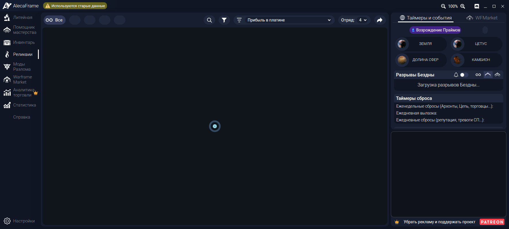

# AlecaFrame-RU

Неофициальный **русский интерфейс для [AlecaFrame](https://alecaframe.com/)**, приложения-компаньона для Warframe, которое работает внутри Overwolf.



<sub>Окно AlecaFrame 2.6.90 в тестовом стенде без данных игры, поэтому списки пустые. Это не снимок из живого Overwolf.</sub>

**[Скачать последнюю версию](https://github.com/TuftyTech/AlecaFrame-RUS/releases/latest)** · [Установка](#установка) · [Как пользоваться](#как-пользоваться) · [Проблемы](#если-что-то-пошло-не-так) · [Сообщить об ошибке](https://github.com/TuftyTech/AlecaFrame-RUS/issues)

## Что это такое

AlecaFrame показывает инвентарь Warframe, цены warframe.market, реликвии, моды Разлома, таймеры и оверлеи в игре. Официально он есть только на английском.

AlecaFrame-RU — набор скриптов для Windows, который на время работы подключает к AlecaFrame перевод и несколько удобств:

- **Перевод всего интерфейса.** Меню, кнопки, настройки, подсказки, оверлеи реликвий и модов Разлома, TennoFinder, список изменений. Переведено 900 из 900 строк AlecaFrame 2.6.90. Термины взяты из официальной русской версии Warframe: Литейная, Моды Разлома, Реликвии, Стальной Путь. Где русский текст длиннее английского, подправлены отступы, чтобы ничего не обрезалось.
- **Дополнительные функции** на вкладке **Настройки → AlecaFrame-RU**: своя тёмная тема, обновление цен с warframe.market, точные цены в окне наград реликвии, сворачивание рекламного блока. Подробнее в разделе [«Как пользоваться»](#как-пользоваться).

Программу AlecaFrame (DLL), её данные и файлы игры проект не меняет. Пока AlecaFrame запущен, в его страницы добавлена одна строка, а при выходе из Overwolf файлы возвращаются в исходный вид.

## Что нужно

- Windows 10 или 11.
- [Overwolf](https://www.overwolf.com/) с установленным **AlecaFrame**, который вы хотя бы раз открывали.
- Больше ничего: Node.js, Python и прочие программы не нужны.

## Установка

1. Откройте **[страницу последней версии](https://github.com/TuftyTech/AlecaFrame-RUS/releases/latest)** и в разделе **Assets** скачайте **Source code (zip)**. Также подойдёт кнопка **Code → Download ZIP** на главной странице репозитория.
2. Распакуйте архив в **постоянную папку**, например `C:\Tools\AlecaFrame-RU`. Не в «Загрузки» и не во временную папку: после установки её нельзя перемещать.
3. Выйдите из игры. Если Overwolf запущен, ничего не делайте: скрипт закроет его сам.
4. Дважды щёлкните **`Start.cmd`**.
   - Windows может показать предупреждение SmartScreen, потому что файл скачан из интернета. Это обычные текстовые скрипты, их можно открыть в Блокноте и прочитать. Нажмите **«Подробнее → Выполнить в любом случае»**.
5. При первом запуске появится описание того, что будет сделано (подробно в разделе [«Важно про безопасность»](#важно-про-безопасность)). Если согласны, введите `да` и нажмите Enter.
6. Подождите, это может занять пару минут. Overwolf перезапустится, AlecaFrame откроется на русском, а в чёрном окне появится надпись «Готово».
7. **Не закрывайте чёрное окно**, пока пользуетесь AlecaFrame. Когда закончите, выйдите из Overwolf (значок в трее → Exit). Файлы AlecaFrame вернутся в исходное состояние, а окно закроется само.

В следующий раз запускайте так же, через `Start.cmd`. Удобно сделать ярлык: правый щелчок по `Start.cmd` → «Отправить → Рабочий стол (создать ярлык)».

> Если открыть AlecaFrame обычным способом, через Overwolf, он будет на английском. Это нормально: перевод подключается только через `Start.cmd`.

## Как пользоваться

Все дополнительные функции находятся на вкладке **Настройки → AlecaFrame-RU** (шестерёнка внизу слева). Настройки общие для всех окон AlecaFrame и сохраняются между запусками. Перевод работает всегда, остальное включается по желанию.


### Тема «Графит»

**Оформление → Тема → «Графит»**: нейтральная тёмная тема без синих и фиолетовых оттенков, с бирюзовым акцентом. Это собственные цвета AlecaFrame-RU, а не платная тема AlecaFrame. Галочка «Применять тему к оверлеям в игре» перекрашивает и окна поверх игры. По умолчанию выключена.

### Свежие цены в инвентаре

Во вкладке **«Инвентарь»** справа вверху есть кнопка **«Обновить цены»**. Она загружает текущие заказы игроков онлайн с warframe.market для показанных предметов через встроенный в AlecaFrame клиент warframe.market.

- Для модов и мистификаторов учитывается ранг, для реликвий — улучшение.
- Запросы идут по одному, не чаще ~3 в секунду, как требует warframe.market. Повторный клик останавливает загрузку.
- Карточка с обновлённой ценой отмечается зелёной точкой. Цены хранятся 1 час, сбросить их можно кнопкой «Сбросить сохранённые цены» в настройках.

### Окно наград реликвии

Когда в игре открывается выбор награды, цены наград уточняются по текущим заказам, и «лучшая» награда подсвечивается по ним. Заодно исправлена ошибка AlecaFrame: когда ни у одной награды нет цены, подсвечивались все карточки сразу, теперь не подсвечивается ни одна. Отключается галочкой «Уточнять цены наград в окне реликвии».

### Свернуть рекламный блок

**Главное окно → «Сворачивать рекламный блок»**. Блок 400×300 справа внизу сжимается в узкую полоску со ссылкой на Patreon, а ��свободившееся место занимают таймеры и события. Чтобы вернуть блок, нажмите **«Показать»** на полоске или снимите галочку.


- По умолчанию выключено: пока вы сами не включите, реклама показывается как обычно.
- Пока блок свёрнут, реклама не загружается. AlecaFrame сам делает так же, когда блок закрывают его окна. Поэтому скрытая реклама не крутится впустую и не засчитывает показы, которых никто не видел.
- Работает только в главном окне. Реклама в окне наград реликвии остаётся.
- Если AlecaFrame вам полезен, поддержите автора на [Patreon](https://www.patreon.com/AlecaFrame): подписка убирает рекламу везде и даёт платные функции.

## Обновление

1. Выйдите из Overwolf (значок в трее → Exit), чтобы чёрное окно закрылось.
2. Скачайте новую версию (**Source code (zip)**) со [страницы релизов](https://github.com/TuftyTech/AlecaFrame-RUS/releases/latest) и скопируйте содержимое архива **поверх** старой папки с заменой файлов.
3. Запустите `Start.cmd`, как обычно.

Если обновился сам AlecaFrame и часть надписей стала английской, значит, в новой версии появились ��овые строки. Напишите в [issues](https://github.com/TuftyTech/AlecaFrame-RUS/issues), их переведут.

## Удаление

Дважды щёлкните **`Uninstall.cmd`**. Он закроет Overwolf, вернёт исходные файлы AlecaFrame и удалит служебную папку `%LOCALAPPDATA%\AlecaFrame-RU`. После этого папку с проектом можно просто удалить.

## Если что-то пошло не так

| Что видите | Что делать |
| --- | --- |
| AlecaFrame на английском | Его открыли через Overwolf, а не через `Start.cmd`. Выйдите из Overwolf и запустите `Start.cmd`. |
| AlecaFrame не открывается или сразу закрывается при обычном запуске | Запустите `Uninstall.cmd`. Так бывает, если чёрное окно закрыли, не выйдя из Overwolf, и часть файлов осталась изменённой. Если не помогло, переустановите AlecaFrame через Overwolf. |
| «Overwolf закрыл AlecaFrame из-за проверки целостности (HashMismatch)» | Ваша сборка Overwolf не принимает такой способ подключения. Файлы уже возвращены, AlecaFrame работает на английском. Создайте [issue](https://github.com/TuftyTech/AlecaFrame-RUS/issues) и приложите `launcher.log` (см. ниже). |
| «Перевод не загрузился» | Создайте issue и приложите `launcher.log`. |
| Часть надписей осталась на английском | Скорее всего, ваша версия AlecaFrame новее 2.6.90. Создайте issue со скриншотом, их переведут. |
| «Обновить цены» пишет «нет связи» | AlecaFrame не ответил на запрос к warframe.market. Проверьте, что игра и AlecaFrame запущены, и нажмите ещё раз. |

Журнал запуска: `%LOCALAPPDATA%\AlecaFrame-RU\launcher.log`. Вставьте этот путь в адресную строку Проводника.

## Важно про безопасность

Overwolf проверяет файлы каждого приложения по подписанному списку и закрывает изменённый AlecaFrame. Поэтому любой способ подключить перевод требует отключить эту проверку. Здесь это сделано так:

- `Start.cmd` запускает Overwolf с флагом `--ow-disable-features=extension-validation,read-opk-from-memory`;
- проверка отключается **для всех приложений Overwolf**, а не только для AlecaFrame, и **только пока открыто окно запуска**. Когда вы выходите из Overwolf, файлы возвращаются в исходное состояние, и обычный запуск снова идёт с проверкой;
- в 9 страниц AlecaFrame добавляется одна строка `<script src="assets/js/alecaframe-ru.js">`, больше ничего не меняется. Если удалить эту строку, файл побайтово совпадёт с исходным, это проверяется тестами;
- пока окно открыто, другие приложения Overwolf не проверяются на подмену. Если вы не готовы на это, пользуйтесь AlecaFrame на английском.

Такой же способ используют существующие китайские переводы AlecaFrame. Более широкий флаг `force-validation-report-only`, который понадобился им на новых сборках Overwolf, здесь **намеренно не используется**.

Чего проект не делает:

- **Не включает платные функции** и не трогает подписку и Patreon: «Аналитика торговли», платные темы и прочее остаются за подпиской. Рекламу он только сворачивает, и только если вы включили это в настройках.
- Не переводит то, что уходит другим людям: сообщения продавцу на WFMarket и уведомления в Discord остаются на английском.

Автор AlecaFrame этот проект не поддерживал и не проверял. Используйте на свой риск.

## Что проверено, а что нет

| | Статус |
| --- | --- |
| Перевод: 900 из 900 строк версии 2.6.90 | Проверено: автотесты, в том числе с Vue 3.2.31 (как в AlecaFrame), и настоящая страница `main.html` в headless Chrome без новых обрезаний текста |
| Подключение и возврат файлов (23 проверки на поддельной папке AlecaFrame, PowerShell 7.4 на Linux) | Проверено |
| **Запуск через настоящий Overwolf** (зак��ыть, запустить с флагом, перезапустить AlecaFrame, прочитать журнал) | **Не проверено.** Код написан по описанию рабочих китайских переводов, но с Overwolf ни разу не запускался |
| **Windows PowerShell 5.1** (встроен в Windows 10/11) | **Не проверено.** Код написан под 5.1 и без синтаксиса PowerShell 7, но запускался только в 7.4 |
| Тема «Графит», «Обновить цены», окно наград реликвии | Проверено: автотесты и настоящие страницы `main.html` и `relicOverlay.html` в headless Chrome с поддельными ответами AlecaFrame |
| Сворачивание рекламного блока | Проверено: автотесты с поддельным рекламным модулем Overwolf и настоящая `main.html` в headless Chrome в окнах 1200×803 и 1600×900. С настоящей рекламой Overwolf не запускалось |
| «Обновить цены» и цены наград на живом warframe.market | **Не проверено.** Используется тот же вызов `GetBuySellWindowData`, что и в окне WTS/WTB AlecaFrame, но с настоящим AlecaFrame он не запускался |
| Экраны с реальными данными игры и оверлеи | Не проверено |
| Версии AlecaFrame, кроме 2.6.90 | Не проверено, новые строки останутся на английском |
| Новые сборки Overwolf | Не проверено. Если Overwolf закроет AlecaFrame, скрипт заметит `HashMismatch`, вернёт файлы и сообщит об этом |

Если запустите и что-то пойдёт не так (или всё получится), напишите в [issues](https://github.com/TuftyTech/AlecaFrame-RUS/issues). Только так можно закрыть пробелы выше.

## Для разработчиков

Нужны Node.js 22.22+ (или 24.15+) и pnpm. Для проверки установщика нужен ещё PowerShell 7 (`pwsh`).

```bash
pnpm install
pnpm test                    # тесты перевода и дополнений (Node, jsdom, Vue 3.2.31)
pnpm test:windows            # тесты установщика (pwsh)
pnpm extract <папка AlecaFrame>   # собрать строки установленной версии -> strings/en.json
pnpm coverage -- --missing   # что ещё не переведено
pnpm build                   # dist/alecaframe-ru.js: перевод + словарь + стили в одном файле
pnpm preview <папка AlecaFrame>   # скриншоты EN/RU и отчёт о переполнениях в preview-out/
pnpm preview:features <папка AlecaFrame>   # тема, «Обновить цены», окно реликвии -> preview-out/features/
```

Папка AlecaFrame: `%LOCALAPPDATA%\Overwolf\Extensions\afmcagbpgggkpdkokjhjkllpegnadmkignlonpjm\<версия>`. Её содержимое в репозиторий не коммитится.

`dist/alecaframe-ru.js` хранится в репозитории, чтобы работала кнопка «Download ZIP». Тест следит, чтобы файл совпадал со сборкой: после правок словарей и `src/` выполните `pnpm build`.

Устройство:

| Часть | Файл | Что делает |
| --- | --- | --- |
| Перевод | `src/localizer.js` | Обходит DOM и через `MutationObserver` переводит текст и атрибуты `title`, `placeholder`, `aria-label`, `data-tippy-content`. Работает с Vue и до запуска приложения, и после |
| Словари | `locales/ru/*.json` | `"English": "Русский"`. Строки с `{0}` — шаблоны, например `"{0} owned": "В наличии: {0}"`. Что переводить нельзя, записано в `locales/ignore.json` |
| Стили | `src/alecaframe-ru.css` | Только отступы под `html[lang="ru"]`, каждое правило подтверждено отчётом превью |
| Дополнения | `src/extras.js`, `src/extras.css`, `src/theme-graphite.css` | Вкладка настроек, «Обновить цены», цены в окне реликвии, тема, сворачивание рекламы. Настройки и кэш цен лежат в `localStorage` под `afru.*`. Тема — переменные `--color-*` AlecaFrame под `html[data-afru-theme="graphite"]`, свёрнутая реклама — `html[data-afru-ads="collapsed"]` |
| Установщик | `windows/*.ps1`, `windows/AlecaFrameRU.psm1` | Подключение и возврат файлов, запуск Overwolf |
| Сборщик строк | `tools/extract.mjs` | Достаёт строки из HTML, выражений Vue и JS установленной версии |
| Превью | `tools/preview.mjs` | Открывает `main.html` в headless Chrome с заглушкой Overwolf на EN и RU, листает вкладки и ищет текст, который обрезается только по-русски |

Нюансы, которые легко сломать:

- `.inventoryItemName` не переводится: AlecaFrame читает этот текст обратно и ищет по нему предмет на warframe.market.
- У `<option>` без `value` английское значение закрепляется до перевода, иначе `v-model` получил бы русское.
- Если перевод фрагмента начинается со знака препинания («, чтобы повторить.»), пробел перед ним убирается.
- Свёрнутая реклама: AlecaFrame держит рекламу в неявной глобальной `currentAd`. `extras.js` перехватывает присваивание, вызывает `removeAd()` после события `ow_internal_rendered` и не даёт `refreshAd()` вернуть рекламу, пока блок свёрнут.
- `window.__AF_RU__.missing()` возвращает тексты, которые встретились без перевода.
- `.cmd` и `.ps1` хранятся в CRLF, а `.ps1` ещё и с BOM (иначе Windows PowerShell 5.1 прочтёт русский текст как ANSI). `.gitattributes` отключает для них преобразование строк.

После выхода новой версии AlecaFrame: `pnpm extract <папка>` → `pnpm coverage -- --missing` → переведите новое в `locales/ru/` → `pnpm build && pnpm test` → `pnpm preview <папка>` и проверьте `preview-out/overflow-report.txt`.

## Благодарности и лицензия

- Способ подключения перевода через Overwolf описан по открытым проектам [AlecaFrame-ZH](https://github.com/191086215333/AlecaFrame-ZH-) (автор «想吃西瓜», MIT) и [его форку](https://github.com/DDA-007/AlecaFrame-ZH) от DDA-007. Их код здесь не используется, всё написано заново.
- AlecaFrame принадлежит Alejandro Cabrerizo. С ним, а также с Digital Extremes и Overwolf проект не связан.
- Код проекта: [MIT](LICENSE).
